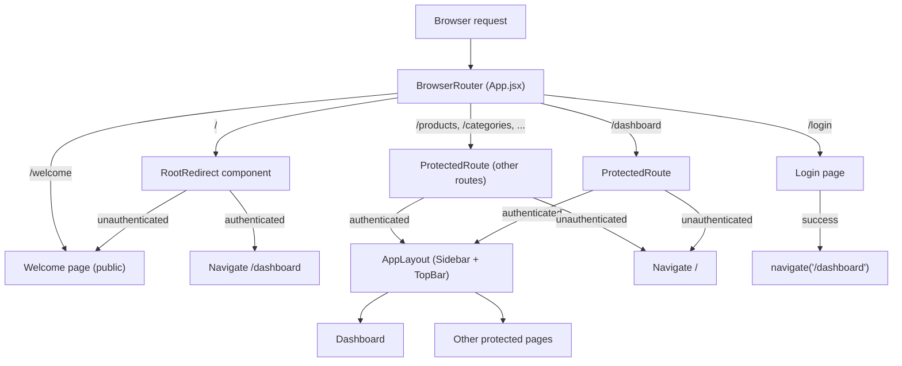

# Design Document

## Welcome Page Upgrade

---

## Overview

This feature restructures the Gestion Ventes SPA routing so the public Welcome page becomes the true root entry point (`/`), the authenticated Dashboard moves to `/dashboard`, and all navigation components are updated consistently. A visual polish pass on `Welcome.jsx` and `Welcome.css` adds entrance animations, improved hero layout, and WCAG 2.1 AA compliance.

The changes are entirely frontend-scoped. No backend modifications are required. The work touches six files: `App.jsx`, `ProtectedRoute.jsx`, `Sidebar.jsx`, `TopBar.jsx`, `Login.jsx`, and the `Welcome.jsx` / `Welcome.css` pair.

---

## Architecture

The application is a React 18 / Vite SPA using React Router v6 for client-side routing and Zustand (with `persist` middleware) for authentication state.



**Key architectural decisions:**

- `RootRedirect` is a thin component that reads auth state and returns either `<Welcome />` or `<Navigate to="/dashboard" replace />`. This keeps the routing logic co-located with the route definition and avoids duplicating auth checks.
- `ProtectedRoute` already redirects to `/` — this is already correct in the current codebase. No change needed there.
- The `/welcome` alias is kept as a static `<Route>` pointing directly to `<Welcome />` (no auth check) for backward compatibility.

---

## Components and Interfaces

### App.jsx — Route Table

The route table is the single source of truth for URL-to-component mapping.

| Route | Component | Auth required | Notes |
|---|---|---|---|
| `/` | `RootRedirect` | No | Renders `<Welcome>` or redirects to `/dashboard` |
| `/welcome` | `Welcome` | No | Backward-compat alias |
| `/login` | `Login` | No | |
| `/dashboard` | `ProtectedRoute > AppLayout > Dashboard` | Yes | |
| `/products` | `ProtectedRoute > AppLayout > ProductsPage` | Yes | |
| `/categories` | `ProtectedRoute > AppLayout > CategoriesPage` | Yes | |
| `/clients` | `ProtectedRoute > AppLayout > ClientsPage` | Yes | |
| `/orders` | `ProtectedRoute > AppLayout > OrdersPage` | Yes | |
| `/users` | `ProtectedRoute > AppLayout > UsersPage` | Yes (Admin) |  |
| `/audit-logs` | `ProtectedRoute > AppLayout > AuditLogsPage` | Yes (Admin) | |
| `*` | `Navigate to="/" replace` | No | Catch-all |

`RootRedirect` interface:

```jsx
// No props. Reads useAuthStore().isAuthenticated internally.
function RootRedirect() { ... }
```

### ProtectedRoute.jsx

No functional change required — the current implementation already redirects to `/` for unauthenticated users and to `/dashboard` for role mismatches. The component is already correct for the new routing structure.

```jsx
// Current signature — unchanged
export default function ProtectedRoute({ children, requiredRole = null })
```

### Sidebar.jsx — NAV array

The `NAV` constant's Dashboard entry already points to `/dashboard`. No change required. Verified by reading the current source.

### TopBar.jsx — PAGE_TITLES

`PAGE_TITLES` already contains a `/dashboard` key. No change required. Verified by reading the current source.

### Login.jsx — Post-login redirect

The `handleSubmit` function already calls `navigate('/dashboard')` on success. No change required. Verified by reading the current source.

### Welcome.jsx — Visual Polish

The Welcome page already has a strong foundation. The polish pass adds:

1. **Entrance animations** — CSS `@keyframes` for `fadeInUp` and `fadeIn`, applied via classes added to hero headline, subtitle, and CTA buttons on mount.
2. **Animation classes** — `.animate-fade-in-up` and `.animate-fade-in` with staggered `animation-delay` values so elements appear sequentially.
3. **Accessible markup** — ensure `<main>` has a landmark role, hero `<h1>` is the single page-level heading, feature cards use `<article>` or `<li>` semantics, and all interactive elements have visible focus styles.
4. **WCAG 2.1 AA contrast** — audit existing color values; the current palette (`#e5e7eb` text on `#0b1020` background) already exceeds 4.5:1. CTA button text (`#fff` on `var(--c1)` indigo) passes. Any borderline values are adjusted.
5. **Responsive layout** — existing media queries cover 980px and 560px breakpoints. Add a 320px floor check to ensure no horizontal overflow on the smallest viewports.

---

## Data Models

This feature involves no new data models. The only state consumed is the existing Zustand auth store shape:

```ts
interface AuthState {
  user: User | null;
  token: string | null;
  isAuthenticated: boolean;
  isLoading: boolean;
  error: string | null;
}
```

`RootRedirect` reads only `isAuthenticated`. No writes to the store occur in any of the changed components.

---

## Correctness Properties

*A property is a characteristic or behavior that should hold true across all valid executions of a system — essentially, a formal statement about what the system should do. Properties serve as the bridge between human-readable specifications and machine-verifiable correctness guarantees.*

### Property 1: All protected routes redirect unauthenticated users to `/`

*For any* route path that is wrapped in `ProtectedRoute`, rendering the application with an unauthenticated auth store state and navigating to that path SHALL result in the user being redirected to `/`.

**Validates: Requirements 3.1**

### Property 2: All protected routes render content for authenticated users

*For any* route path that is wrapped in `ProtectedRoute`, rendering the application with an authenticated auth store state and navigating to that path SHALL render the protected page content (not a redirect).

**Validates: Requirements 3.2**

### Property 3: All unknown routes redirect to `/`

*For any* path string that is not defined in the router's route table, navigating to that path SHALL result in the user being redirected to `/`.

**Validates: Requirements 6.1**

### Property 4: All CTA buttons on the Welcome page navigate to `/login`

*For any* element on the Welcome page that is rendered as a primary call-to-action button or link, clicking or activating that element SHALL navigate the user to `/login`.

**Validates: Requirements 7.8**

---

## Error Handling

### Redirect loop prevention

The only redirect targets introduced are `/` (public, always renders) and `/dashboard` (protected, redirects to `/` if unauthenticated). There is no cycle:

- Unauthenticated user → `/dashboard` → ProtectedRoute → `/` → Welcome (renders, stops)
- Authenticated user → `/` → RootRedirect → `/dashboard` → Dashboard (renders, stops)

No infinite loop is possible because the redirect targets are always one step away from a terminal render.

### Auth store hydration race

Zustand `persist` rehydrates from `localStorage` synchronously on store creation. By the time React renders `RootRedirect`, `isAuthenticated` is already the correct persisted value. No loading state or suspense boundary is needed for this feature.

### Unknown route handling

The catch-all `<Route path="*" element={<Navigate to="/" replace />} />` uses `replace` so the unknown URL is not pushed onto the history stack. The user can navigate back normally.

---

## Testing Strategy

### Unit / Example-based tests

These cover the specific scenarios from the requirements:

| Test | Requirement |
|---|---|
| Unauthenticated user at `/` renders Welcome | 1.1 |
| Authenticated user at `/` redirects to `/dashboard` | 1.2 |
| `/welcome` renders Welcome (unauthenticated) | 1.3 |
| Authenticated user at `/dashboard` renders Dashboard | 2.1 |
| Unauthenticated user at `/dashboard` redirects to `/` | 2.2 |
| Role-mismatch user on role-restricted route redirects to `/dashboard` | 3.3 |
| Catch-all uses `replace` navigation | 6.2 |
| Welcome hero section contains h1, subtitle, and CTA to `/login` | 7.1 |
| Welcome renders at least 4 feature cards | 7.2 |
| Welcome renders final CTA section | 7.3 |
| Welcome hero elements have animation CSS classes on render | 7.4 |
| Welcome hero section contains mock dashboard element | 7.5 |
| Successful login calls `navigate('/dashboard')` | 8.1, 8.2 |

### Property-based tests

Property-based testing is applicable here because Requirements 3.1, 3.2, 6.1, and 7.8 express universal behaviors that should hold across a range of inputs (all protected paths, all unknown paths, all CTA elements).

**Library:** [fast-check](https://github.com/dubzzz/fast-check) (JavaScript/TypeScript PBT library, well-maintained, works with Vitest).

**Configuration:** Minimum 100 runs per property (`numRuns: 100`).

**Tag format:** `// Feature: welcome-page-upgrade, Property {N}: {property_text}`

| Property | Test description | Generator |
|---|---|---|
| Property 1 | For any protected path, unauthenticated → redirect to `/` | `fc.constantFrom(...protectedPaths)` |
| Property 2 | For any protected path, authenticated → renders content | `fc.constantFrom(...protectedPaths)` |
| Property 3 | For any unknown path, redirect to `/` | `fc.string()` filtered to exclude defined routes |
| Property 4 | For any CTA button on Welcome, click → navigate to `/login` | `fc.constantFrom(...ctaSelectors)` |

### Smoke / configuration checks

- `PAGE_TITLES` contains `/dashboard` key (TopBar)
- `PAGE_TITLES` does not contain a `/` key mapping to Dashboard title
- `NAV` array in Sidebar has Dashboard entry pointing to `/dashboard`
- Welcome CSS contains media queries for 980px, 560px, and 320px breakpoints
- WCAG 2.1 AA contrast: manual audit with browser DevTools contrast checker + automated `axe-core` scan

### Accessibility note

Full WCAG 2.1 AA validation requires manual testing with assistive technologies (screen readers such as NVDA/VoiceOver) and expert accessibility review. Automated tools like `axe-core` catch a subset of issues but cannot replace manual testing.
